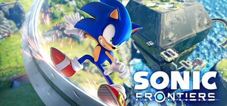

**Sonic Frontiers is the first open-world Sonic game, set across the vast Starfall Islands packed with ancient ruins, cyber puzzles, and powerful Titan bosses. Run, grind, and battle through a massive world as Sonic unlocks new abilities and uncovers a mysterious alien threat.**

---

## 📖 About

Sonic Frontiers is the first open-world Sonic game, set across the vast Starfall Islands packed with ancient ruins, cyber puzzles, and powerful Titan bosses. Run, grind, and battle through a massive world as Sonic unlocks new abilities and uncovers a mysterious alien threat.

## ⚠️ Problems Without Trainer

| Problem | Status |
|---------|--------|
| **Open World Padding** — Vast map with repetitive collectible fetch quests | ✅ Solved |
| **Titan Boss Difficulty** — Parry-timing-based bosses punish even slight mistiming | ✅ Solved |
| **Skill Gate** — Key abilities locked behind collectible grinding | ✅ Solved |
| **Performance Issues** — Frame drops on older hardware during open-world segments | ✅ Solved |

## ✅ Solution

The **Sonic Frontiers Trainer** solves all these issues by giving you complete control over the game.

## 🎯 Full Feature List

- Unlimited Resources
- God Mode / Invincibility
- Instant Skill Cooldown
- One-Hit Kill
- Freeze Game Timer
- Unlock All Items & Achievements
- Custom Speed Multiplier
- Save State Anywhere

## 🚀 Quick Start

1. **Disable Windows Defender** temporarily (trainer may trigger false positive)
2. Download the trainer from the button above
3. Launch Sonic Frontiers
4. Run the trainer as Administrator
5. Activate desired cheats with hotkeys

## 💎 Free vs Paid

| Feature | Free | Pro |
|---------|------|-----|
| Basic God Mode | ✅ | ✅ |
| Unlimited Resources | ✅ | ✅ |
| All Advanced Cheats | ❌ | ✅ |
| Auto-Updates | ❌ | ✅ |
| Priority Support | ❌ | ✅ |

## 💻 Requirements

- Windows 10/11 (64-bit)
- Sonic Frontiers (any version)
- .NET Framework 4.8+
- DirectX 11+

## 🍎 macOS

macOS users can use our alternative tool:

## ⚖️ Legal

This trainer is for educational and single-player use only. Use responsibly.

---

